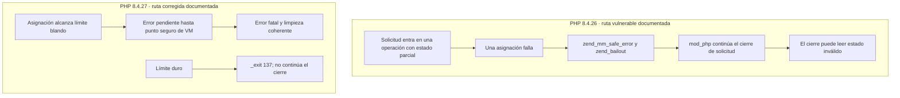
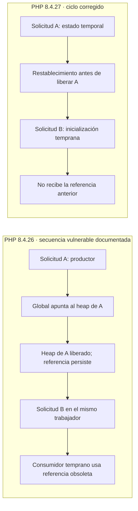

# Guía del instructor · Archivo Costero

**Sesión:** martes 27 de octubre de 2026. **Objetivo:** explicar los mecanismos de CVE-2026-109618 y CVE-2026-109619 con PHP 8.4.26 y 8.4.27, sin atribuir una CVE a un error HTTP, un OOM ordinario o un PID repetido.

## Fuentes y alcance de las afirmaciones

| Tipo | Qué puede afirmarse en clase |
|---|---|
| **Medido en este laboratorio** | El control `scripts/demo-oom.sh` alcanzó `memory_limit=16M` por CLI en ambas imágenes el 25-10-2026. Ambos procesos CLI salieron con código 255 y los contenedores siguieron activos y sanos. Las trazas locales quedan en `evidence/`; esta carpeta no viaja con Git. |
| **Confirmado por PHP** | Los [avisos de 109618](https://github.com/php/php-src/security/advisories/GHSA-w8hw-w9fx-j79w) y [109619](https://github.com/php/php-src/security/advisories/GHSA-6wmf-4rv5-p3rp), y el [parche conjunto](https://github.com/php/php-src/commit/31c0ea7d), describen los mecanismos y la corrección de la rama 8.4 en 8.4.27. |
| **Ilustrativo** | Los diagramas muestran el orden relevante de las operaciones documentadas. No representan una traza de corrupción observada en Archivo Costero. |

Las pruebas `.phpt` incluidas en `php-src` son pruebas **oficiales** del cambio: [límite OOM blando](https://github.com/php/php-src/blob/31c0ea7d/Zend/tests/oom_soft_limit_exceeded.phpt), [análisis de solicitud](https://github.com/php/php-src/blob/31c0ea7d/Zend/tests/oom_request_parsing.phpt), [solicitud siguiente tras OOM](https://github.com/php/php-src/blob/31c0ea7d/sapi/cli/tests/oom_request_parsing_next_request.phpt) y [manejo temprano de sesión](https://github.com/php/php-src/blob/31c0ea7d/ext/session/tests/rfc1867_no_user_code.phpt). Sus SAPI y configuraciones no equivalen automáticamente al Apache/mod_php de este laboratorio. Los verificadores de [ikow/php2shell-poc](https://github.com/ikow/php2shell-poc) son material independiente: no forman parte de la suite oficial de PHP ni de este procedimiento.

## CVE-2026-109618: error temprano y cierre de solicitud

En 8.4.26, `zend_mm_safe_error()` informa el agotamiento y termina con `zend_bailout()`; el aviso describe contextos donde el salto deja datos de la solicitud accesibles antes de completar su inicialización. Apache/mod_php puede invocar `php_request_shutdown()` después de fallar el inicio de la solicitud, y el cierre puede consumir ese estado inválido. El parche sustituye esa ruta por `zend_mm_check_limit()` y `zend_mm_delayed_error()`: el OOM blando queda pendiente hasta un punto seguro de la VM (`zend_handle_delayed_oom()`). Si se alcanza el límite duro, `zend_mm_hard_limit_error()` sale del proceso con `_exit(137)` en vez de continuar con memoria incompleta. Véanse [`Zend/zend_alloc.c`](https://github.com/php/php-src/blob/31c0ea7d/Zend/zend_alloc.c) y [`main/main.c`](https://github.com/php/php-src/blob/31c0ea7d/main/main.c).



**Control docente:** `demo-oom.sh` provoca una asignación ordinaria de 32 MiB con `memory_limit=16M` en un proceso **CLI** separado. Enseña qué significa el error de PHP y permite distinguirlo del OOM del contenedor. No ejecuta el inicio multipart vulnerable, no observa el cierre de una solicitud mod_php fallida y **no reproduce CVE-2026-109618**. Los bytes de la asignación informados por cada versión pueden diferir sin constituir evidencia de corrupción.

## CVE-2026-109619: estado global entre solicitudes

El aviso oficial describe un productor que publica un puntero a memoria propiedad de una solicitud. Si un error fatal o una fase tardía de limpieza omite el restablecimiento, el trabajador conserva el puntero después de liberar el heap de esa solicitud. Un consumidor temprano en una solicitud posterior del **mismo trabajador** puede usarlo antes de la inicialización ordinaria. Un diagnóstico INI previo al inicio y el ciclo de `session.upload_progress` son consumidores documentados; la exposición exacta depende de SAPI, configuración y secuencia.

El parche limpia valores globales en `zend_shutdown_executor_values()` y `php_request_shutdown()` —incluidos estado de errores, manejadores y `PG(http_globals)`— y ajusta `php_rinit_session_globals()`, `php_session_rfc1867_update()` y `php_session_rfc1867_cleanup()` para el tratamiento temprano de sesiones. Véanse [`Zend/zend_execute_API.c`](https://github.com/php/php-src/blob/31c0ea7d/Zend/zend_execute_API.c), [`main/main.c`](https://github.com/php/php-src/blob/31c0ea7d/main/main.c) y [`ext/session/session.c`](https://github.com/php/php-src/blob/31c0ea7d/ext/session/session.c).



**Análisis de clase:** `compare-workers.sh` muestra el PID de una solicitud diagnóstica; `diagnose-cve.sh` conserva procesos, eventos y logs. La igualdad de PID entre dos respuestas es una condición necesaria para la secuencia publicada, pero no demuestra que A haya dejado una referencia obsoleta ni que B la haya consumido. `docker top` muestra PID del anfitrión, que no deben confundirse con `getmypid()` dentro de PHP. No se presenta un ejemplo sintético como reproducción de la CVE.

## Preparación en Kali

Con Docker Engine y las imágenes ya disponibles, desde la raíz del repositorio:

```bash
git pull origin main
bash scripts/lab.sh start
bash scripts/verify.sh
```

Si las imágenes se distribuyeron por el paquete offline, ejecutar primero `bash scripts/offline.sh import`. El control utiliza `timeout` de GNU coreutils, Docker Compose y `sha256sum`; Kali los proporciona habitualmente. No se compilan imágenes durante la clase.

## Secuencia de clase (30 minutos)

1. **Minutos 0–8:** mostrar la tabla de fuentes y el primer diagrama. Señalar `zend_mm_safe_error()`, el salto temprano, el cierre mod_php y la diferencia entre límite PHP y límite del contenedor.
2. **Minutos 8–15:** ejecutar el control CLI en orden, una versión cada vez:

   ```bash
   bash scripts/demo-oom.sh vulnerable clase-27
   bash scripts/demo-oom.sh patched clase-27
   V=$(ls -dt evidence/*-vulnerable-oom-clase-27 | head -n1)
   P=$(ls -dt evidence/*-patched-oom-clase-27 | head -n1)
   for D in "$V" "$P"; do
       printf '\n%s\n' "$D"
       cat "$D/oom-case.txt"
       cat "$D/oom-stderr.txt"
       cat "$D/oom-state-after.json"
   done
   ```

3. **Minutos 15–24:** mostrar el segundo diagrama. Seguir el puntero de A a B, ubicar el requisito de mismo trabajador y explicar los restablecimientos del parche. Revisar una captura previa de `compare-workers.sh` o ejecutar `bash scripts/compare-workers.sh` únicamente para ver la identidad de trabajadores, sin interpretarla como prueba de estado obsoleto.
4. **Minutos 24–30:** contrastar evidencia y límites. `bash scripts/lab.sh status` y `bash scripts/verify.sh` comprueban que Archivo Costero responde después del control. El informe `scripts/compare-cve.py` sirve para capturas diagnósticas de solicitudes experimentales; el control CLI tiene su propia evidencia `oom-case.txt` y no se introduce en ese comparador como si fuera una solicitud HTTP.

## Lectura de resultados y límites

| Observación | Interpretación permitida |
|---|---|
| `Allowed memory size ... exhausted` en `oom-stderr.txt` y salida 255 | OOM de PHP CLI bajo el límite indicado. |
| `OOMKilled=true` en `oom-state-after.json` | OOM del contenedor; el control no cumple su expectativa. |
| Contenedor activo y saludable después | El control CLI no interrumpió el servicio web. |
| Misma respuesta en ambas versiones | Resultado esperado de un límite ordinario; no descarta ni confirma las CVE. |
| PID de dos solicitudes igual | Solo identidad de trabajador; falta la traza del estado productor y consumidor. |

Las imágenes principales no tienen símbolos de depuración ni sanitizers ni contienen el árbol `php-src` y su ejecutor `.phpt`. Esas pruebas oficiales requieren un entorno independiente con las extensiones y SAPI especificados por cada caso. En la VM de 3,8 GiB, una compilación instrumentada debe prepararse **secuencialmente**, con paralelismo limitado y espacio revisado, y sin sustituir las imágenes principales. Una traza ASan/depurador correlacionada con la operación afectada sería necesaria para sostener corrupción de memoria local. La sesión docente no declara reproducción de ninguna CVE.
